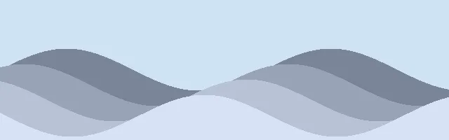
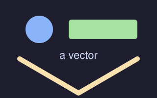

# A picture takes the room left in its column

An image keeps its own proportions and sits in the middle of the box it is given.
The alt text is the shape's description, which is what PowerPoint's alt-text pane
shows and what a screen reader reads.


---

# A picture the package cannot carry

A deck that names no alt text gets the path it wrote in its place, because an
empty description says nothing at all.

That picture is a **WebP**. A `.pptx` carries GIF, JPEG, PNG and SVG and nothing
else, so this one is decoded and re-encoded as PNG on the way in — the part in
the package really is a PNG, which is why a deck full of converted photographs is
several times the size it was written from.



---
layout: two-column
---

# A picture in one column of two



## The right column

A vector is taken on its extension and never measured, and it is the only one of
these three that is not re-encoded.

```php
$renderer = new PresentationRenderer(__DIR__);
$renderer->render($deck, 'deck.pptx');
```

Columns divide at the first `##` in the body, so everything above this one —
the picture included — is the left column.

---
layout: image-text
---

## image-text


## The text beside the picture

The picture takes the **wider** column and the text the narrower one, because a
reader looks at the image first. The two are separated by the same gutter a
bullet is from its text.

`image-text` divides at the first `##` exactly as `two-column` does, so the
picture — everything above this heading — is the left column.

---
layout: image-title
---

## image-title


---
layout: image-slide
---


<!--
No heading and no `title:` on this slide, which is the point of the layout: the picture is
the slide. A title named here would be drawn as a heading above it, which is what `blank`
does with a title for the same reason — and would stop the slide being the picture alone.
-->